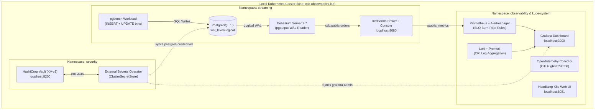

# Cloud-Native Real-Time CDC & SRE Observability Platform

A production-style, local-first Infrastructure-as-Code (IaC) platform built with **Terraform** and **Terragrunt** on Kubernetes (`kind`). It implements an end-to-end **Zero-Hardcoded-Secrets Change Data Capture (CDC)** pipeline streaming transactional events from **PostgreSQL 16** through **Debezium Server** into **Redpanda**, backed by full-stack **SRE Observability** (**Prometheus**, **Grafana**, **Loki**, **OpenTelemetry**) and **multi-window SLO error-budget burn-rate alerting**.

---

## Architecture Overview



---

## Key Engineering Highlights

* **DRY Layered Terragrunt DAG (`live/local-kind/`):** Orchestrates four isolated, composable Terraform modules (`01-cluster` -> `02-security` -> `03-streaming` -> `04-observability`) with explicit cross-stack `dependency` outputs.
* **Zero-Hardcoded-Secrets GitOps Security:** Terraform generates cryptographically random credentials (`hashicorp/random`), seeds them into **HashiCorp Vault KV-v2** (`secret/trading/postgres`, `secret/observability/grafana`, `secret/platform/headlamp`), and synchronizes them into Kubernetes via **External Secrets Operator (ESO)** using Kubernetes ServiceAccount JWT authentication.
* **Real-Time Write-Ahead Log (WAL) Streaming:** Captures row-level `INSERT` and `UPDATE` mutations from PostgreSQL (`REPLICA IDENTITY FULL`) via **Debezium Server** (Apache 2.0) into **Redpanda** (`cdc.public.orders`) with offset state persisted in Kafka (`debezium.offsets`).
* **Automated Provisioning & SRE Alerting:** Automatically provisions a custom Grafana CDC & SRE dashboard (`ConfigMap` sidecar), scrapes Redpanda's `/public_metrics` via `ServiceMonitor`, aggregates container logs via Promtail/Loki, and evaluates `PrometheusRule` alerts for connector outages and fast SLO error-budget burn.

---

## Repository Structure

```text
cdc-observability-platform/
├── Makefile                                  # One-command lifecycle (up, down, stress, creds, status)
├── modules/
│   ├── kind-cluster/                         # Multi-node kind cluster + host NodePort mappings
│   ├── security-vault/                       # HashiCorp Vault, K8s Auth, ESO & ClusterSecretStore
│   ├── streaming-cdc/                        # Postgres 16, Redpanda, Debezium Server & pgbench Job
│   └── observability-uis/                    # Prometheus, Grafana, Loki, OTel, Headlamp & SLO alerts
└── live/local-kind/
    ├── root.hcl                              # Shared local backend & K8s/Helm/Kubectl providers
    ├── 01-cluster/terragrunt.hcl             # Layer 1: Kubernetes cluster
    ├── 02-security/terragrunt.hcl            # Layer 2: Vault & External Secrets
    ├── 03-streaming/terragrunt.hcl           # Layer 3: CDC streaming pipeline & load generator
    └── 04-observability/terragrunt.hcl       # Layer 4: Metrics, logs, dashboards, UIs & SLO alerts
```

---

## Prerequisites

* **Docker** (running with >= 4 GB RAM allocated)
* **Terraform** (`>= 1.6`) & **Terragrunt** (`>= 0.70`)
* **kind**, **kubectl**, and **helm**

---

## Quickstart

### 1. Deploy the Entire Platform
```bash
make up
```
This builds all four layers in dependency order (`01-cluster` -> `04-observability`), kicks off an initial `pgbench` CDC workload, and prints all local UI URLs and credentials.

### 2. Access the Web Consoles

| Service | Local URL | Credentials / Auth |
| :--- | :--- | :--- |
| **HashiCorp Vault** | `http://localhost:8200` | Token: `root` (Stores `trading/postgres`, `observability/grafana`, `platform/headlamp`) |
| **Redpanda Console** | `http://localhost:8080` | No auth required — inspect live JSON events in `Topics -> cdc.public.orders` |
| **Grafana** | `http://localhost:3000` | User: `admin` / Password printed by `make creds` (or in Vault) |
| **Headlamp K8s UI** | `http://localhost:8081` | Token stored in Vault (`secret/platform/headlamp`) or via `make headlamp-token` |

---

## Load Testing & SRE Chaos Runbook

### Trigger a Custom CDC Load Burst
Run `pgbench` to generate continuous transactional `INSERT` + `UPDATE` order mutations (`10 TPS` = `20 CDC events/sec`):
```bash
# Default: 10 TPS for 600 seconds
make stress

# High-throughput spike: 50 TPS for 120 seconds
make stress TPS=50 DURATION=120
```

### Chaos Drill: Connector Outage & Zero-Data-Loss WAL Recovery
Verify that PostgreSQL replication slots buffer uncommitted WAL changes during a Debezium outage while Prometheus fires an SLO alert:

1. **Simulate a Debezium outage** while `make stress` is actively writing orders:
   ```bash
   kubectl --kubeconfig=live/local-kind/01-cluster/kubeconfig \
     -n streaming scale deploy/debezium-server --replicas=0
   ```
2. **Observe SLO Alerting:** Open **Grafana (`http://localhost:3000`) -> Alerting -> Alert rules -> `cdc-slo-burn-rate`**. Within 30 seconds, **`CDCConnectorDown`** transitions from `Normal` -> `Pending` -> `Firing`, and the Grafana dashboard stat card flips to **`DOWN (0)`**.
3. **Restore Debezium & Verify Replay:**
   ```bash
   kubectl --kubeconfig=live/local-kind/01-cluster/kubeconfig \
     -n streaming scale deploy/debezium-server --replicas=1
   ```
   Debezium reconnects to its PostgreSQL replication slot (`debezium_orders_cdc`), drains every buffered WAL transaction into **Redpanda Console (`http://localhost:8080`)** with zero lost events, and automatically resolves the alert.

---

## Teardown

Destroy all layers in reverse dependency order and delete the local `kind` cluster:
```bash
make down
```
