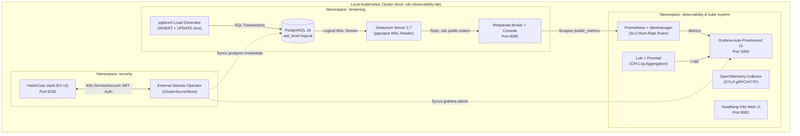

# Cloud-Native Real-Time CDC & SRE Observability Platform

A production-style, local-first Infrastructure-as-Code (IaC) platform built with **Terraform** and **Terragrunt** on Kubernetes (`kind`). It implements a **Zero-Hardcoded-Secrets Change Data Capture (CDC)** pipeline streaming transactional database mutations from **PostgreSQL 16** through **Debezium Server** into **Redpanda**, backed by full-stack **SRE Observability** (**Prometheus**, **Grafana**, **Loki**, **Promtail**, **OpenTelemetry**) and **SLO error-budget burn-rate alerting**.

---

## Architecture & End-to-End Data Flow



---

## Deep Dive: Tools Used & How They Work Together

### 1. Cluster & Infrastructure-as-Code Layer (`01-cluster`)
* **Docker & `kind` (Kubernetes in Docker):**
  * **Role:** Runs a multi-node Kubernetes cluster (`1 control-plane` + `1 worker` container) locally on Docker.
  * **Integration:** Configures `extraPortMappings` on the worker node so host ports (`8200`, `8080`, `8081`, `3000`) forward directly to Kubernetes `NodePort` services (`30820`, `30080`, `30081`, `30300`), eliminating manual `kubectl port-forward` commands.
* **Terraform & Terragrunt:**
  * **Role:** Terraform defines reusable infrastructure modules (`modules/*`), while Terragrunt orchestrates four layered environments (`live/local-kind/01-cluster` -> `04-observability`).
  * **Integration:** Each downstream `terragrunt.hcl` declares `dependency` blocks to read outputs from upstream layers (e.g., `03-streaming` consumes `kubeconfig_path` from `01-cluster` and `cluster_secret_store_name` from `02-security`).

### 2. Secrets Management & Zero-Trust Layer (`02-security`)
* **HashiCorp Vault (KV-v2 Secret Engine):**
  * **Role:** Centralizes and encrypts all credentials (`secret/trading/postgres`, `secret/observability/grafana`, and `secret/platform/headlamp`).
  * **Integration:** During deployment, Terraform's `hashicorp/random` provider generates 24-character passwords and writes them directly into Vault—ensuring zero plaintext passwords exist in Git, `.tf` files, or environment variables.
* **External Secrets Operator (ESO):**
  * **Role:** Bridges HashiCorp Vault and native Kubernetes `Secrets`.
  * **Integration:** ESO authenticates to Vault via Vault's **Kubernetes Auth Backend** (`auth/kubernetes/role/external-secrets`) using its Kubernetes ServiceAccount JWT verified against `kube-root-ca.crt`. Through `ClusterSecretStore` (`vault-backend`), ESO reconciles `ExternalSecret` manifests in `streaming` and `observability` into native Kubernetes `Secrets` (`postgres-credentials` and `grafana-admin`).

### 3. Real-Time CDC Streaming & Load Layer (`03-streaming`)
* **PostgreSQL 16 (`wal_level=logical`):**
  * **Role:** Serves as the transactional OLTP source database (`trading`) storing `public.orders`.
  * **Integration:** Configured with `wal_level=logical` and `ALTER TABLE public.orders REPLICA IDENTITY FULL` so every `INSERT`, `UPDATE`, and `DELETE` writes complete before-and-after row data into the Write-Ahead Log (WAL).
* **`pgbench` Workload Generator:**
  * **Role:** Simulates live trading order flow against PostgreSQL.
  * **Integration:** Runs as a Kubernetes `Job` executing `orders_workload.sql`, performing paired `INSERT` (`status='NEW'`) and `UPDATE` (`status='FILLED'`) transactions at a configurable TPS (`10 TPS` = `20 CDC events/sec` by default).
* **Debezium Server 2.7 (Apache 2.0):**
  * **Role:** Performs log-based Change Data Capture without polling or adding query load to PostgreSQL.
  * **Integration:** Connects to `postgres.streaming.svc.cluster.local:5432` via PostgreSQL's native `pgoutput` logical decoding plugin using a persistent replication slot (`debezium_orders_cdc`). Serializes WAL row changes into JSON events, publishes them to Redpanda (`cdc.public.orders`), and checkpoints its Log Sequence Number (LSN) into Redpanda's `debezium.offsets` topic.
* **Redpanda & Redpanda Console:**
  * **Role:** Redpanda is a C++ Kafka-API-compatible streaming broker (no ZooKeeper or JVM required), paired with Redpanda Console for visual stream inspection.
  * **Integration:** Receives CDC events on internal DNS (`redpanda.streaming.svc.cluster.local:9093`), exposes topic throughput metrics on `:9644/public_metrics` for Prometheus, and serves the web console on `localhost:8080`.

### 4. SRE Observability, Alerting & Cluster UI Layer (`04-observability`)
* **Prometheus & Alertmanager (`kube-prometheus-stack`):**
  * **Role:** Collects time-series metrics across the cluster and evaluates SLO alerting rules.
  * **Integration:** A custom `ServiceMonitor` (`redpanda-cdc-monitor`) scrapes Redpanda's `/public_metrics` every `5s` alongside `kube-state-metrics` and `cAdvisor`. A `PrometheusRule` (`cdc-pipeline-slo-alerts`) evaluates `CDCConnectorDown` and `CDCPipelineHighErrorBudgetBurn`.
* **Grafana:**
  * **Role:** Provides unified visualization across metrics, logs, and alerts.
  * **Integration:** Logs in using the `grafana-admin` Secret synced from Vault, connects to Prometheus and Loki datasources, and auto-loads a Terraform-provisioned dashboard (`ConfigMap` labeled `grafana_dashboard: "1"`).
* **Loki & Promtail:**
  * **Role:** Provides centralized log aggregation without heavy indexing overhead.
  * **Integration:** Promtail runs as a `DaemonSet` across every `kind` node, parses containerd CRI logs, attaches Kubernetes labels, and ships log streams to `loki.observability.svc.cluster.local:3100`.
* **OpenTelemetry Collector:**
  * **Role:** Acts as a vendor-neutral telemetry ingestion pipeline.
  * **Integration:** Exposes OTLP gRPC (`:4317`) and HTTP (`:4318`) receivers and exports metrics to Prometheus (`:8889`) for downstream trace and metric ingestion.
* **Headlamp Kubernetes Web UI:**
  * **Role:** Offers a real-time graphical dashboard for inspecting Kubernetes nodes, pods, deployments, and events.
  * **Integration:** Runs on `localhost:8081` and authenticates via a `cluster-admin` ServiceAccount (`headlamp-platform-admin`) whose persistent token is stored in HashiCorp Vault (`secret/platform/headlamp`).

---

## Makefile Commands Reference

All platform lifecycle operations are wrapped in the root `Makefile`:

| Command | Description |
| :--- | :--- |
| **`make up`** | Deploys the entire 4-layer platform (`01-cluster` -> `02-security` -> `03-streaming` -> `04-observability`) in dependency order and prints all UI URLs and credentials. |
| **`make down`** | Tears down all layers in reverse dependency order (`04` -> `03` -> `02` -> `01`) and deletes the local `kind` cluster cleanly. |
| **`make plan`** | Runs `terragrunt run --all -- plan` across all four layers to preview infrastructure changes before applying. |
| **`make stress`** | Triggers a fresh `pgbench` CDC workload against PostgreSQL (`10 TPS` = `20 CDC events/sec` for `600s` by default). |
| **`make stress TPS=50 DURATION=120`** | Overrides default load parameters to fire a high-throughput burst (`50 TPS` = `100 CDC events/sec` for `2 minutes`). |
| **`make creds`** | Prints the local URLs for Vault, Redpanda Console, Headlamp, and Grafana along with the decoded Grafana admin password. |
| **`make headlamp-token`** | Mints a fresh Kubernetes ServiceAccount JWT for logging into Headlamp (`localhost:8081`). |
| **`make status`** | Displays the live status of every pod across `security`, `streaming`, `observability`, and `kube-system`. |

---

## Local Web Consoles

| Service | Address | Login / Notes |
| :--- | :--- | :--- |
| **HashiCorp Vault** | `localhost:8200` | Token: `root` -> Browse `secret/` for `trading/postgres`, `observability/grafana`, and `platform/headlamp` |
| **Redpanda Console** | `localhost:8080` | Open **Topics -> `cdc.public.orders`** to watch live JSON CDC messages stream in |
| **Grafana** | `localhost:3000` | User: `admin` / Password via `make creds` -> Open **Dashboards -> `CDC Pipeline & SRE Observability`** |
| **Headlamp K8s UI** | `localhost:8081` | Paste the token from Vault (`secret/platform/headlamp`) or `make headlamp-token` |

---

## SRE Chaos Drill: Connector Outage & Zero-Loss WAL Recovery

1. **Start background traffic:**
   ```bash
   make stress
   ```
2. **Simulate a Debezium CDC outage:**
   ```bash
   kubectl --kubeconfig=live/local-kind/01-cluster/kubeconfig \
     -n streaming scale deploy/debezium-server --replicas=0
   ```
3. **Verify SLO Alerting:** In **Grafana (`localhost:3000`) -> Alerting -> Alert rules -> `cdc-slo-burn-rate`**, watch **`CDCConnectorDown`** transition from `Normal` -> `Pending` -> `Firing` within 30 seconds while PostgreSQL retains uncommitted WAL changes in the `debezium_orders_cdc` replication slot.
4. **Recover & Verify Zero Data Loss:**
   ```bash
   kubectl --kubeconfig=live/local-kind/01-cluster/kubeconfig \
     -n streaming scale deploy/debezium-server --replicas=1
   ```
   Debezium automatically drains every buffered WAL transaction into `cdc.public.orders` in Redpanda and resolves the alert.
