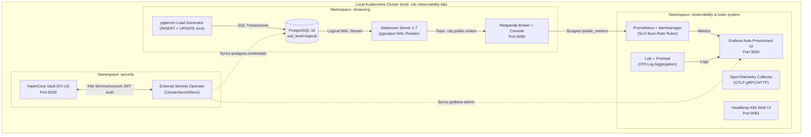

# Cloud-Native Real-Time CDC & SRE Observability Platform

A production-style, local-first Infrastructure-as-Code (IaC) platform built with **Terraform** and **Terragrunt** on Kubernetes (`kind`). It implements a **Zero-Hardcoded-Secrets Change Data Capture (CDC)** pipeline that streams transactional database mutations from **PostgreSQL 16** through **Debezium Server** into **Redpanda**, backed by full-stack **SRE Observability** (**Prometheus**, **Grafana**, **Loki**, **Promtail**, **OpenTelemetry**) and **multi-window SLO error-budget burn-rate alerting**.

---

## Architecture & End-to-End Data Flow



---

## Tech Stack & How Every Tool Works Together

### 1. Infrastructure & Orchestration Layer (`01-cluster`)
* **Docker & `kind` (Kubernetes in Docker):** Provisions a multi-node local Kubernetes cluster (`1 control-plane` + `1 worker`) with `extraPortMappings` (`8200`, `8080`, `8081`, `3000`) routed directly to NodePorts on the worker node so all UIs are reachable on `localhost` without manual `kubectl port-forward`.
* **Terraform & Terragrunt:** Organizes infrastructure into four decoupled, reusable Terraform modules (`modules/`) orchestrated by Terragrunt (`live/local-kind/`). Terragrunt automatically resolves cross-layer `dependency` outputs (`kubeconfig_path`, `cluster_secret_store_name`, `streaming_namespace`) in a strict Directed Acyclic Graph (DAG).

### 2. Zero-Hardcoded-Secrets Security Layer (`02-security`)
* **HashiCorp Vault (KV-v2):** Acts as the single source of truth for all platform secrets. Terraform generates random 24-character passwords (`hashicorp/random`) at deploy time and writes them into Vault (`secret/trading/postgres`, `secret/observability/grafana`, and `secret/platform/headlamp`)—zero plaintext credentials exist in Git or `.tf` files.
* **External Secrets Operator (ESO):** Authenticates against Vault using Vault's **Kubernetes Auth Backend** (verifying Kubernetes ServiceAccount JWTs against the cluster's `kube-root-ca.crt`). ESO continuously reconciles `ExternalSecret` resources into native Kubernetes `Secrets` (`postgres-credentials` and `grafana-admin`) across namespaces.

### 3. Real-Time CDC Streaming & Load Layer (`03-streaming`)
* **PostgreSQL 16 (`wal_level=logical`):** Runs an `orders` table configured with `REPLICA IDENTITY FULL` so both before-and-after row images are written to the Write-Ahead Log (WAL) on every mutation.
* **`pgbench` Stress Generator:** Runs a custom transactional SQL workload (`orders_workload.sql`) that executes paired `INSERT` (`status='NEW'`) and `UPDATE` (`status='FILLED'`) statements against `public.orders` at a configurable TPS rate.
* **Debezium Server 2.7 (Apache 2.0):** Connects to PostgreSQL via the native `pgoutput` logical decoding plugin using a dedicated replication slot (`debezium_orders_cdc`), converts WAL row changes into structured JSON CDC events (`"op":"c"` for inserts, `"op":"u"` for updates), and stores connector offsets in Redpanda (`debezium.offsets`).
* **Redpanda & Redpanda Console:** A Kafka-API-compatible streaming engine (`redpanda.streaming.svc.cluster.local:9093`) hosting the partitioned `cdc.public.orders` topic, paired with **Redpanda Console** on port `8080` for real-time topic, partition, consumer-group, and JSON payload inspection.

### 4. SRE Observability, Dashboards & UI Layer (`04-observability`)
* **Prometheus & Alertmanager (`kube-prometheus-stack`):** Scrapes Redpanda's `/public_metrics` endpoint every `5s` via a custom `ServiceMonitor` (`redpanda-cdc-monitor`) alongside Kubernetes `kube-state-metrics` and `cAdvisor` container metrics. Evaluates `PrometheusRule` alerts (`CDCConnectorDown` and `CDCPipelineHighErrorBudgetBurn`) for fast SLO error-budget burn.
* **Grafana:** Boots with its admin password synced from Vault via ESO and automatically loads a custom **CDC Pipeline & SRE Observability** dashboard (`ConfigMap` with `grafana_dashboard: "1"`). Visualizes live Debezium replica health, real-time `cdc.public.orders` throughput (`events/sec`), cumulative delivered events, committed offsets, pod memory working sets, and live container logs.
* **Loki & Promtail:** Promtail runs as a DaemonSet tailing containerd CRI logs across every node and ships structured log streams into Loki, which Grafana queries natively alongside Prometheus metrics.
* **OpenTelemetry Collector:** Deployed with `otlp` gRPC (`:4317`) and HTTP (`:4318`) receivers and a Prometheus metrics exporter (`:8889`) ready for distributed trace and custom application telemetry ingestion.
* **Headlamp Kubernetes Web UI:** Provides a modern cluster dashboard on port `8081` authenticated via a persistent `cluster-admin` ServiceAccount token stored in Vault (`secret/platform/headlamp`).

---

## Makefile Commands Reference

All platform lifecycle operations are wrapped in the root `Makefile`:

| Command | Description |
| :--- | :--- |
| **`make up`** | Deploys the entire 4-layer platform (`01-cluster` -> `02-security` -> `03-streaming` -> `04-observability`) in dependency order and prints all UI URLs and credentials. |
| **`make down`** | Tears down all layers in reverse dependency order (`04` -> `03` -> `02` -> `01`) and deletes the local `kind` cluster cleanly. |
| **`make plan`** | Runs `terragrunt run --all -- plan` across all four layers to preview infrastructure changes before applying. |
| **`make stress`** | Triggers a fresh `pgbench` CDC workload against PostgreSQL (`10 TPS` = `20 CDC events/sec` for `600s` by default). |
| **`make stress TPS=50 DURATION=120`** | Overrides default load parameters to fire a high-throughput burst (`50 TPS` = `100 CDC events/sec` for `2 minutes`). |
| **`make creds`** | Prints the local URLs for Vault, Redpanda Console, Headlamp, and Grafana along with the decoded Grafana admin password. |
| **`make headlamp-token`** | Mints a fresh Kubernetes ServiceAccount JWT for logging into Headlamp (`localhost:8081`). |
| **`make status`** | Displays the live status of every pod across `security`, `streaming`, `observability`, and `kube-system`. |

---

## Local Web Consoles

| Service | Address | Login / Notes |
| :--- | :--- | :--- |
| **HashiCorp Vault** | `localhost:8200` | Token: `root` -> Browse `secret/` for `trading/postgres`, `observability/grafana`, and `platform/headlamp` |
| **Redpanda Console** | `localhost:8080` | Open **Topics -> `cdc.public.orders`** to watch live JSON CDC messages stream in |
| **Grafana** | `localhost:3000` | User: `admin` / Password via `make creds` -> Open **Dashboards -> `CDC Pipeline & SRE Observability`** |
| **Headlamp K8s UI** | `localhost:8081` | Paste the token from Vault (`secret/platform/headlamp`) or `make headlamp-token` |

---

## SRE Chaos Drill: Connector Outage & Zero-Loss WAL Recovery

1. **Start background traffic:**
   ```bash
   make stress
   ```
2. **Simulate a Debezium CDC outage:**
   ```bash
   kubectl --kubeconfig=live/local-kind/01-cluster/kubeconfig \
     -n streaming scale deploy/debezium-server --replicas=0
   ```
3. **Verify SLO Alerting:** In **Grafana (`localhost:3000`) -> Alerting -> Alert rules -> `cdc-slo-burn-rate`**, watch **`CDCConnectorDown`** transition from `Normal` -> `Pending` -> `Firing` within 30 seconds while PostgreSQL retains uncommitted WAL changes in the `debezium_orders_cdc` replication slot.
4. **Recover & Verify Zero Data Loss:**
   ```bash
   kubectl --kubeconfig=live/local-kind/01-cluster/kubeconfig \
     -n streaming scale deploy/debezium-server --replicas=1
   ```
   Debezium automatically drains every buffered WAL transaction into `cdc.public.orders` in Redpanda and resolves the alert.
